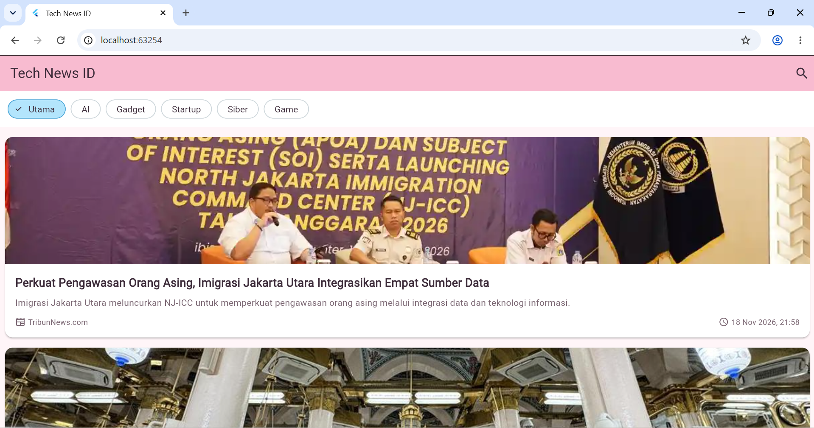
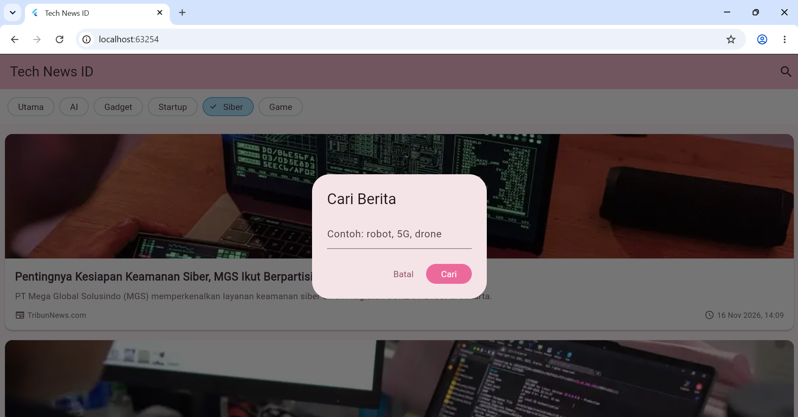
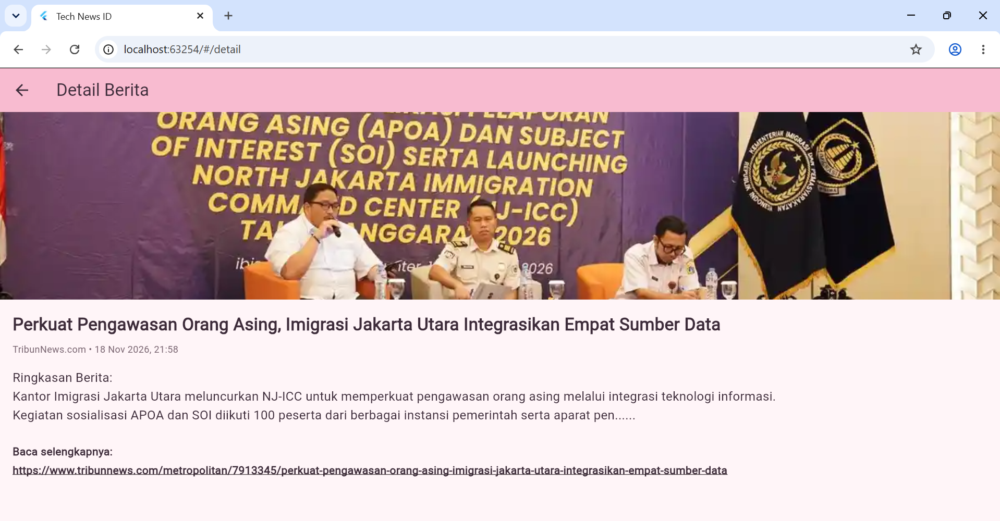
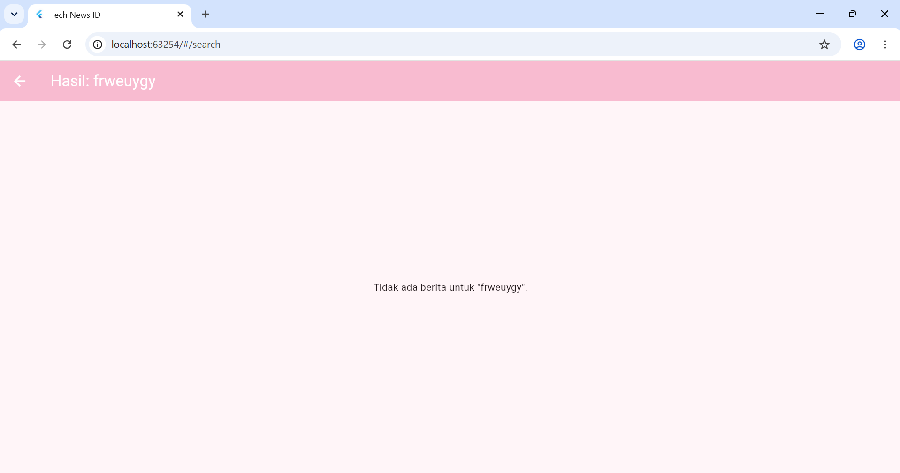
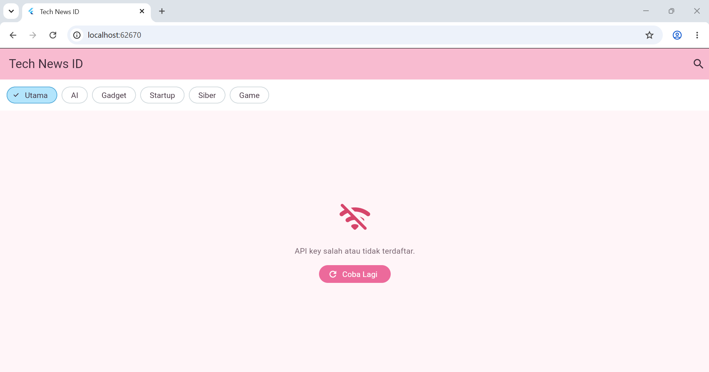
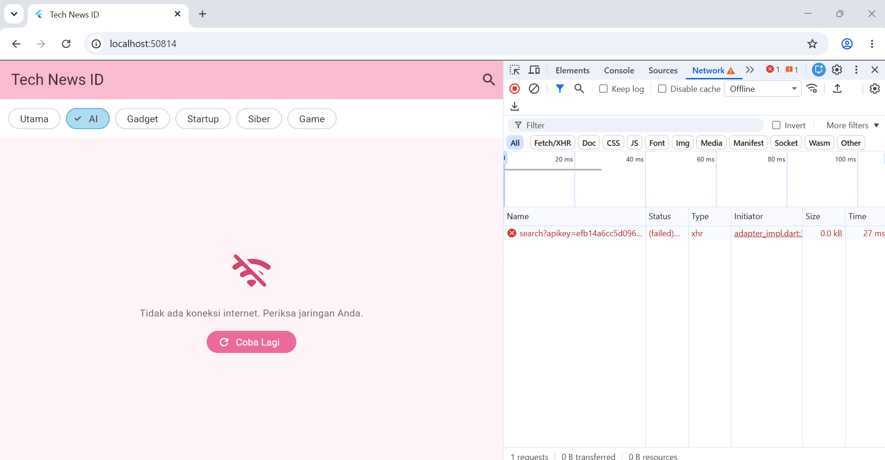
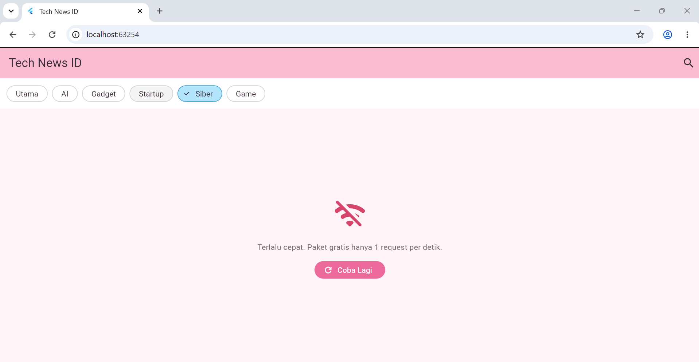
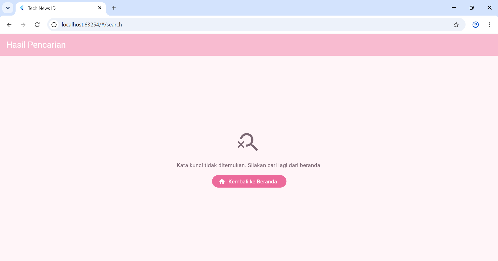

# Tech News ID

Aplikasi berita teknologi Indonesia berbasis Flutter, mengambil data dari GNews API.

## Fitur

- Daftar berita dengan FutureBuilder (4 state: loading, error, kosong, data)
- Pilihan topik lewat chip: Utama, AI, Gadget, Startup, Siber, Game
- Pencarian berita lewat ikon di AppBar, hasil tampil di halaman baru
- Cache hasil per topik (Map) agar hemat kuota API
- Halaman detail berita
- Pull-to-refresh
- Error handling dengan ApiException dan tombol Coba Lagi

## Cara Menjalankan

1. Daftar di https://gnews.io dan ambil API key
2. Salin `config/env.example.json` menjadi `config/env.json`
3. Isi API key pada `config/env.json`
4. Jalankan:

```bash
flutter pub get
flutter run --dart-define-from-file=config/env.json
```

Untuk browser tambahkan `-d chrome`.

## Struktur Folder

```
lib/
├── config/        # pembaca konfigurasi
├── models/        # ArticleModel, NewsResponseModel
├── services/      # NewsApiService, ApiException
├── views/         # HomeView, SearchView, DetailView
├── widgets/       # ArticleCard, ErrorView, NewsImage, SearchDialog
├── controllers/   # DetailController
├── routes/        # AppRoutes, AppPages
└── utils/         # AppColors, DateFormatter
```

## Screenshot

### Halaman utama


### Dialog cari


### Hasil pencarian


### Detail berita


### Hasil pencarian kosong


### Skenario error 1: API key salah (401)


### Skenario error 2: tidak ada internet


### Skenario error 3: terlalu cepat (429)


### Tombol Coba Lagi berhasil memuat ulang


### Halaman tanpa kata kunci
